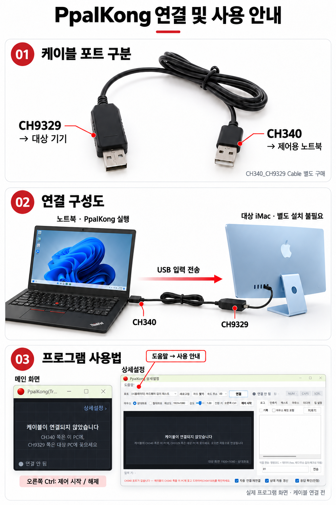

# PPalKongKM

씽크패드 노트북을 ThinkPad TrackPoint Keyboard처럼 활용하는 KM(Keyboard Mouse) 앱입니다. 키보드·트랙포인트 입력을 CH340/CH9329 케이블을 통해 대상 기기로 전달합니다.

**현재 버전: 0.0.6**

## 다운로드 및 설치

[최신 버전 다운로드](https://github.com/yanghanjin-dev/PPalKongKM/releases/latest)

- 일반 설치: **PPalKongKM-Setup-0.0.6.exe**를 실행하세요. 실행 파일과 필수 언어팩이 함께 설치됩니다.
- 기본 경로: C:\Program Files\PPalKongKM. 설치 시 Windows 관리자 승인(UAC)을 요청하며 모든 사용자가 사용할 수 있게 설치합니다.
- 설치 없이 사용: **PPalKongKM-0.0.6-Windows.zip**을 모두 풀고 PPalKongKM.exe를 실행하세요. languages 폴더를 함께 유지하세요.

설치형은 Windows 10/11 x64 호환 환경용입니다. 시작 메뉴 실행·제거 바로가기를 제공하고 바탕 화면 바로가기는 선택할 수 있습니다. 설치·제거 시 관리자 승인이 필요합니다. 앱 자체는 일반 권한으로 실행합니다.

## 마우스 뒤로·앞으로 및 좌우 스크롤

상세설정의 **마우스 → 뒤로 / 앞으로**를 클릭하면 대상 PC로 탐색 명령을 보냅니다. 제어 중에는 Logitech MX Master 4의 엄지 버튼도 사용할 수 있습니다. Windows가 해당 입력을 표준 마우스 뒤로·앞으로 버튼 또는 브라우저 키로 전달할 때 동작합니다.

상세설정의 **마우스 → 가로 휠 모드**에서 왼쪽과 오른쪽을 각각 설정할 수 있습니다. 대상 앱이 Edge이면 **Edge (Shift + 휠)**, Excel이면 **Excel (Ctrl + Shift + 휠)**을 양쪽에 선택하세요. 선택은 즉시 저장되며, **휠 왼쪽 / 휠 오른쪽** 버튼과 제어 중 MX Master 4 엄지 휠이 같은 설정을 사용합니다. 엄지 휠 입력은 Windows에서 가로 휠 이벤트로 전달되어야 합니다.

## 연결 및 사용

**CH340/CH9329 케이블은 별도 구매가 필요합니다. CH340 드라이버는 포함하지 않습니다.**

1. CH340 쪽을 PPalKongKM을 실행할 Windows 씽크패드 노트북에 연결합니다.
2. CH9329 쪽을 입력을 받을 대상 기기에 연결합니다.
3. 앱을 실행하면 포트와 통신 속도를 자동으로 찾습니다.
4. 연결 후 오른쪽 Ctrl을 눌렀다 떼면 제어를 시작하고, 다시 누르면 해제합니다. 전환 키는 상세설정에서 변경할 수 있습니다.
5. 상세설정의 도움말에서 연결·사용 안내를 확인하세요.

프로그램은 제어 노트북에서만 실행합니다. 대상 기기에는 별도 프로그램이 필요하지 않습니다. PC의 BIOS/UEFI, macOS, Android 및 스마트폰 등은 해당 기기·화면의 USB 키보드/마우스 입력 및 USB 호스트 지원에 따라 사용할 수 있습니다. 모든 대상의 호환성을 검증한 것은 아닙니다.

위 이미지와 앱 내 안내 이미지는 기존 PpalKong의 0.1.2 화면과 한국어 문구를 유지합니다. 현재 앱 이름은 PPalKongKM이며 UI와 도움말 본문은 한국어·영어·일본어·중국어 간체를 지원합니다.

## 언어 및 업데이트

상세설정의 언어 메뉴에서 저장하면 재실행 없이 바로 적용됩니다. 입력값·선택값·장치 연결은 유지되며 기존 로그와 이미지 안의 문구는 바뀌지 않습니다. 누락된 번역은 영어로 표시합니다.

상세설정 → 업데이트에서 수동 확인과 하루 한 번 자동 확인(기본 켜짐)을 제공합니다. 새 버전 다운로드와 설치는 각각 사용자가 선택합니다. 대상 PC 제어 중에는 안내·설치를 미루며, 앱 종료 후 실행 파일과 필수 언어팩을 교체하고 다시 실행합니다. 설정은 유지하고 교체 오류 시 기존 파일을 복원합니다.

설치형 업데이트는 설치 EXE를 다운로드·검증한 뒤 관리자 승인을 요청합니다. 승인 후 앱을 종료하고 설치하며 원래 사용자의 권한으로 다시 실행합니다. 승인 취소 시 현재 앱을 종료하지 않습니다. 버전 확인·다운로드에는 PowerShell 5.1과 인터넷 연결이 필요하고, 포터블 ZIP 업데이트에는 해당 폴더 쓰기 권한이 필요합니다. 공식 GitHub HTTPS API와 자산 SHA-256·크기·ZIP 파일 목록·실행 파일 버전을 검증합니다. 별도 배포자 코드 서명은 적용하지 않았습니다. 요청에 키보드·마우스 입력이나 설정·로그는 포함하지 않으며 GitHub는 IP 주소 등 네트워크 요청 정보를 처리할 수 있습니다.

## 제거 및 설정

먼저 트레이 메뉴에서 앱을 종료한 뒤 Windows 설정 → 앱 → 설치된 앱 → PPalKongKM → 제거를 선택하세요. 시작 메뉴에서도 제거할 수 있습니다. 실행 중에는 설치·제거를 진행하지 않으며 제어 중인 앱을 강제 종료하지 않습니다.

설정은 %USERPROFILE%\.ppalkongkm.ini에 별도로 보관합니다. 기존 PpalKong의 설정·설치와 분리되어 있습니다. 제거 후에도 설정·사용자 추가 파일·언어팩·로그·복구 백업을 유지하므로 설치 폴더가 남을 수 있습니다.

## 기존 0.0.1 설치 전환

0.0.2부터 기본 설치 위치는 전체 사용자용 Program Files입니다. 설치·제거·설치형 업데이트만 관리자 승인을 요청하고 일반 실행에는 관리자 권한을 요구하지 않습니다. Windows 설치된 앱 등록은 전체 사용자용으로 관리합니다.

기존 0.0.1 사용자별 설치는 먼저 해당 사용자 계정에서 제거한 뒤 0.0.6 설치 EXE를 실행하세요. 설정 파일은 보존됩니다. 동일 계정의 이전 사용자별 등록이 감지되면 중복 설치를 막고 제거 방법을 안내합니다. 다른 계정에 남아 있는 사용자별 설치도 그 계정에서 제거하세요. ZIP 자동 업데이트만으로 설치 위치가 Program Files로 이동하지는 않습니다.

## 프로젝트 안내

기존 PpalKong의 키보드·마우스 제어, 다국어 UI·도움말, 실시간 언어 변경, 자동 업데이트, 설치·제거 기능을 포함하는 별도 프로젝트입니다. 앱 이름, 실행 파일, 설치 ID, 중복 실행 방지 이름, 설정 파일과 업데이트 저장소를 독립 구성했습니다. 이후 기능 개선 시 패치 버전을 1씩 올립니다.

실제 검증 결과와 알려진 제한은 Release 설명을 확인하세요. 실제 케이블·모든 대상 기기 호환성은 별도 검증이 필요합니다. 전원 차단 중 다중 파일 교체의 원자성은 보장하지 않습니다.

## 저장소 운영

실행 파일·설치 프로그램·필수 언어팩과 공개 사용 안내를 위한 배포 저장소입니다. 소스·테스트·빌드 스크립트·개발 문서는 공개하지 않습니다.